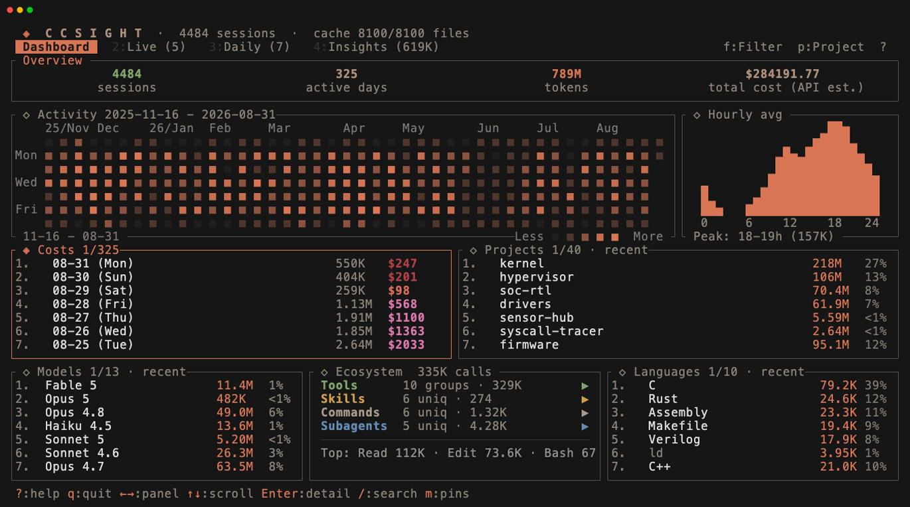
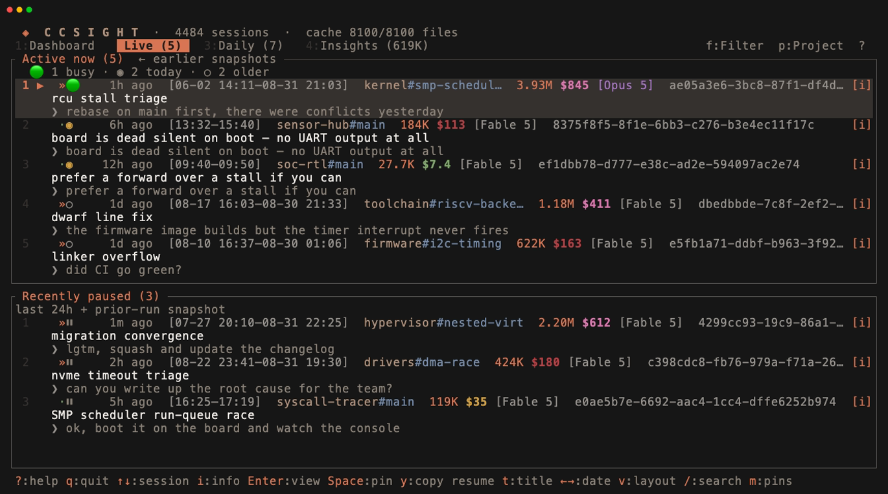
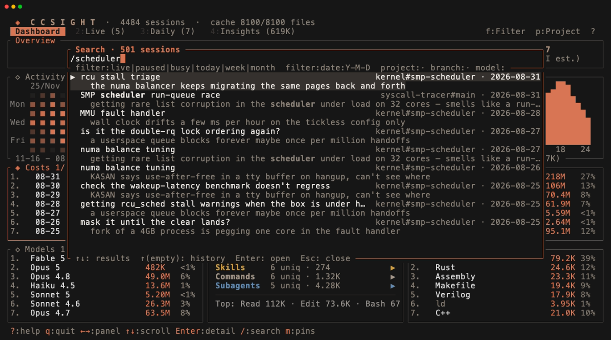
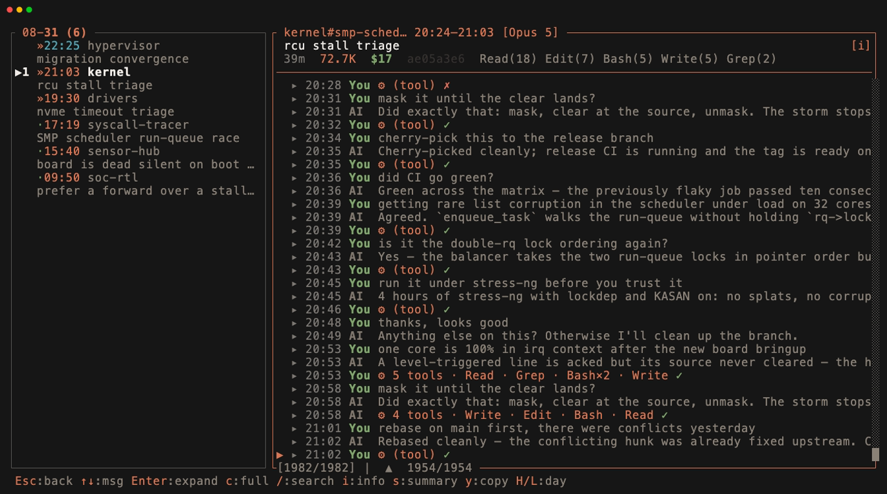
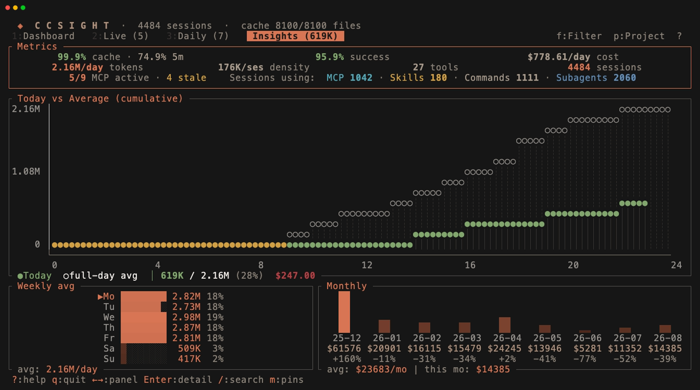
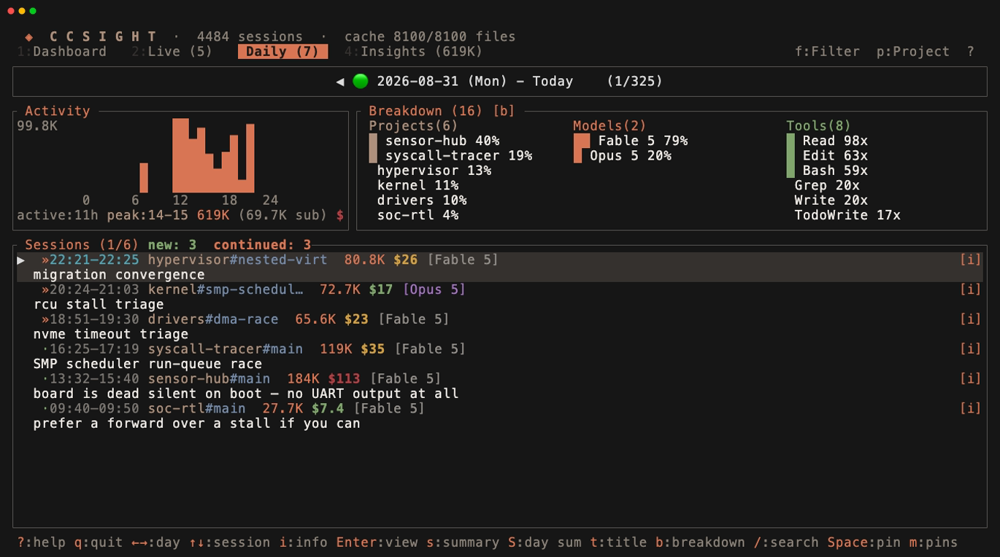

# ccsight

Claude Code session analytics in the terminal, read from your local
`~/.claude/` logs.



## Why ccsight

`/usage` and other trackers already give you cost totals. ccsight is built
around three things they don't:

- **Find & resume past work** — full-text search (tantivy) over every
  conversation, straight into the transcript viewer, then copy a ready-to-paste
  `claude -r` resume command.
- **Know when a session needs you** — the Live tab tracks busy / paused
  sessions (surviving reboots), and `--wait` blocks on one session until it
  is awaiting input, stalled, errored, exited mid-task, or ended.
- **Audit your setup** — every MCP server, skill, command, and subagent
  classified as active, stale, or installed-but-never-invoked.

Plus the usual analytics: cost with the 5m / 1h cache-write TTL split,
subagent-inclusive totals that reconcile across every view, per-project /
model / tool / language breakdowns, heatmap, hourly pattern, and weekly /
monthly trends.




<details>
<summary>More screenshots: Daily view</summary>



</details>

## Installation

Homebrew:

```bash
brew install esorae/tap/ccsight
```

crates.io:

```bash
cargo install ccsight
```

From source, inside a clone:

```bash
cargo install --path .
```

> **macOS**: a binary downloaded straight from GitHub Releases needs `xattr -d com.apple.quarantine ccsight`. Homebrew and `cargo install` are not affected.

## Usage

```bash
ccsight                              # TUI
ccsight --daily | --weekly | --monthly [--json]
ccsight --wait <id> && say "done"    # block until that session needs you
ccsight --mcp                        # MCP server over stdio
```

`ccsight --help` lists every flag; `?` in the TUI lists the key bindings.

### Reading the numbers

Token figures labelled **work**, and the headline "tokens" totals, count
input + output only — cache traffic dominates raw volume and would drown
them. **Cost** always includes everything: input, output, both cache-write
TTLs, and cache reads. A `$?` (or trailing `*`) marks a figure involving a
model with no known pricing.

### Search filters

Press `/` inside the TUI to open the search popup. Plain queries match
projects, summaries, branches, dates, and conversation content. Add any
of these tokens to narrow the result set further:

| Token | Effect |
|-------|--------|
| `filter:live` / `filter:paused` / `filter:busy` | Limit to sessions in the current Live / paused / busy poll |
| `filter:today` / `filter:week` / `filter:month` | Rolling window (local timezone): today, last 7 days, last 30 days |
| `filter:date:YYYY-MM-DD` | Exact date |
| `project:NAME` / `branch:NAME` / `model:NAME` | Substring match (case-insensitive) |

Tokens can be combined freely with each other and with free text:

```text
/filter:today project:ccsight             # today's ccsight sessions
/filter:month model:opus mcp setup        # last 30 days, Opus, containing "mcp setup"
```

A conversation-content match counts only when the matched message was
written inside the date range, not merely when its session was active then.
The Live tab pre-fills `filter:live `, and the search popup renders recognised tokens as chips so you can confirm parsing.

## MCP Server

```bash
claude mcp add --scope user ccsight -- ccsight --mcp
```

Four tools over stdio: `stats`, `sessions` (with `conversation_query`),
`search`, `live_sessions`. The first three take `date_from` / `date_to`
(`YYYY-MM-DD`, local timezone; `search` applies them to the matched
message's date); `live_sessions` reports the current poll.
Other hosts: add `ccsight --mcp` as a stdio server.

## Data Source

Reads inputs from these locations:

- **`~/.claude/projects/<project>/<session>.jsonl`** — session logs (conversation
  history, tool calls, token usage). Discovered recursively at startup.
- **`~/.claude.json`** + enabled-plugin `.mcp.json` — Claude Code's MCP config.
  Used to classify each MCP server as **active**, **stale** (configured but
  idle, including never used), or **inactive** (in logs but no longer in any
  config).
- **`~/.claude/{skills,commands,agents}/`** + enabled-plugin paths — installed
  Skills / Commands / Subagents. Surfaced as zero-call rows in the Tools popup
  for entries you've installed but never invoked.
- **`~/Library/Application Support/Claude/local-agent-mode-sessions/`** *(macOS only)*
  — Claude Desktop "Cowork" sessions. The format is undocumented, so a session
  that stops parsing is skipped rather than failing the run.

State lives under `~/.ccsight/`: the parsed-session cache, the full-text
index, pins, and live-session history. `--clear-cache` keeps pins and history.

## License

[MIT](LICENSE-MIT) OR [Apache-2.0](LICENSE-APACHE)
